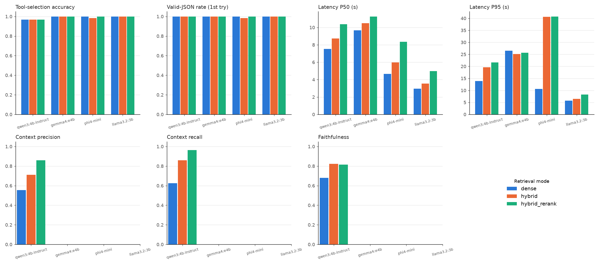
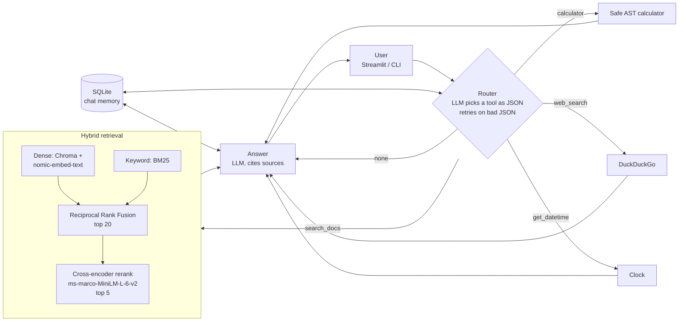
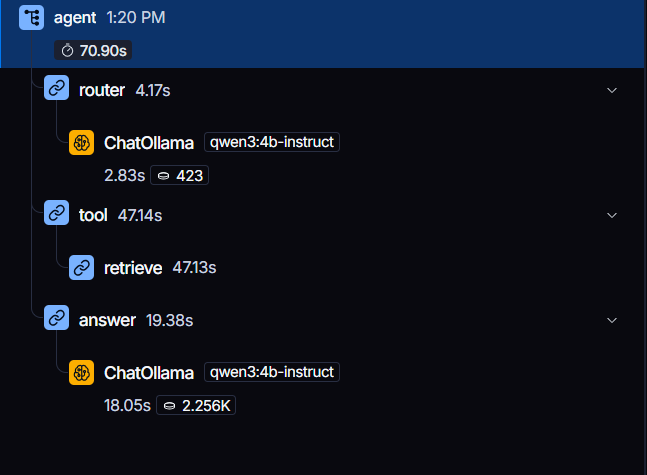
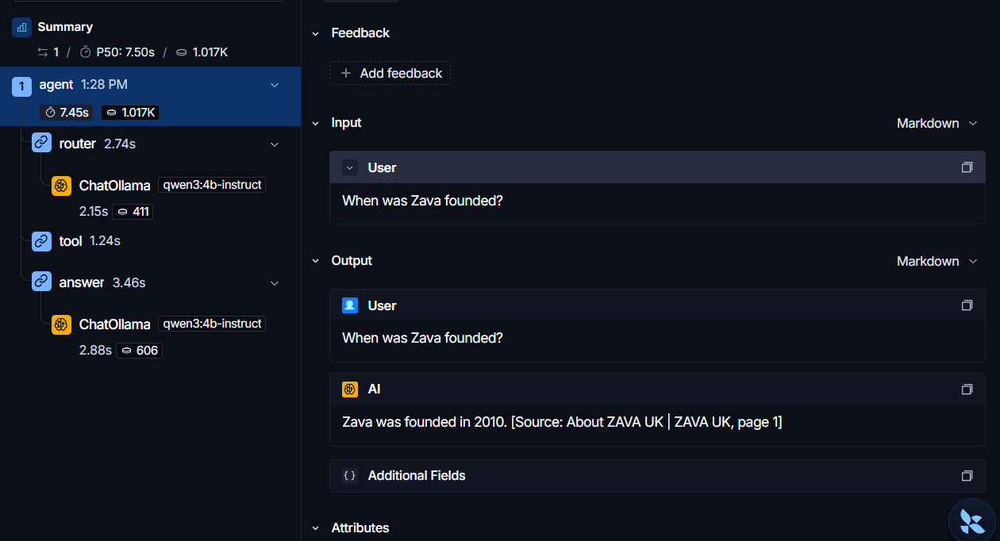

# Multi-Source Agentic RAG

A local LangGraph agent that answers questions from company documents with hybrid retrieval and cited sources, and routes other questions to a calculator, web search or the clock. It runs entirely on Ollama.

## Results

60 questions (36 document, 10 calculator, 8 web, 6 date/time) on a laptop RTX 3050 (4 GB). Full data: [`eval/results.csv`](eval/results.csv), chart: [`eval/results.png`](eval/results.png).

**Agent: tool routing and speed** (ranges across the 3 retrieval modes)

| Model | Tool accuracy | Valid JSON (1st try) | P50 latency | P95 latency |
|---|---|---|---|---|
| llama3.2:3b | **1.00** | 1.00 | **3.0–5.0 s** | **5.7–8.2 s** |
| phi4-mini | 0.98–1.00 | 0.98–1.00 | 4.7–8.3 s | 10.6–40.8 s |
| gemma4:e4b | 1.00 | 1.00 | 9.7–11.3 s | 25.2–26.5 s |
| qwen3:4b-instruct | 0.97* | 1.00 | 7.5–10.4 s | 13.8–21.6 s |

\* Both misses were Zava history questions routed to web search. That was fixed after the eval (see [Observability](#observability)).

**Retrieval quality** (ragas, qwen3:4b-instruct as judge, 34 document questions per mode)

| Retrieval mode | Context precision | Context recall | Faithfulness |
|---|---|---|---|
| dense | 0.556 | 0.625 | 0.679 |
| hybrid (dense + BM25, RRF) | 0.710 | 0.860 | 0.824 |
| **hybrid + rerank** (default) | **0.858** | **0.962** | 0.816 |

Each retrieval step pays off: hybrid search with a cross-encoder reranker finds the supporting chunk for 96% of answers, against 63% for dense search alone.



## Architecture



- **Ingest** (`src/ingest.py`): PDFs and Markdown in `data/` are split into ~500-token chunks with overlap, embedded, and stored in ChromaDB.
- **Retrieval** (`src/retrieve.py`): `dense`, `hybrid` or `hybrid_rerank`, set by `retrieval_mode` in `config.yaml`.
- **Agent** (`src/agent.py`): a LangGraph graph `router → tool → answer`, with SQLite chat memory so follow-up questions ("And for the Plus plan?") work.
- **UI** (`src/app.py`): Streamlit chat with session picker, model and retrieval-mode switches, and the retrieved chunks.

## Demo


## Setup in 3 commands

Needs Docker with the NVIDIA container toolkit (without an NVIDIA GPU, delete the `deploy:` block in `docker-compose.yml`).

```bash
git clone https://github.com/UmarKhattab09/MultiSourceAgentic_RAG.git && cd MultiSourceAgentic_RAG
docker compose up -d --build
# open http://localhost:8501
```

The first start pulls `qwen3:4b-instruct` and `nomic-embed-text` (about 3 GB) and indexes `data/`. Follow it with `docker compose logs -f app`.

<details>
<summary>Without Docker</summary>

Install [Ollama](https://ollama.com), then:

```bash
ollama pull qwen3:4b-instruct && ollama pull nomic-embed-text
python -m venv .venv && .venv\Scripts\activate        # macOS/Linux: source .venv/bin/activate
pip install -r requirements-dev.txt
python src/ingest.py             # build the index from data/
streamlit run src/app.py         # or: python src/agent.py for the terminal chat
```
</details>

## Reproduce the eval

Run these from a non-Docker install, with Ollama running.

```bash
ollama pull gemma4:e4b && ollama pull phi4-mini && ollama pull llama3.2:3b
python eval/run_eval.py agent                          # tool accuracy, JSON rate, latency: 4 models x 3 modes, ~2 h
python eval/run_eval.py ragas                          # ragas for qwen3 x 3 modes, ~3 h on a 4 GB GPU
python eval/run_eval.py ragas phi4-mini llama3.2:3b    # optional: grade other models' answers with the same judge
python eval/plot_results.py                            # redraw eval/results.png
```

- Questions and expected answers: [`eval/questions.jsonl`](eval/questions.jsonl).
- Both passes save as they go and resume where they stopped. Delete `eval/results.csv`, `details.csv` and `ragas_scores.csv` for a fresh run.
- Turn LangSmith tracing off (`LANGSMITH_TRACING=false`) before a full run, or every ragas grading call is traced too.

## Observability

With `LANGSMITH_API_KEY` and `LANGSMITH_TRACING=true` in `.env`, every agent run is traced to LangSmith. `python eval/trace_eval.py` sends the whole eval set as tagged traces.



The first question of a run includes one-time model loading, which is why retrieval takes 47 s in this trace; later questions retrieve in under a second.

Tracing explained the eval's two routing misses. The router sent "When was Zava founded?" to web search, which found a different company and answered "2010" (the documents say 1985):



Naming Zava's history topics in the router prompt fixed both questions.

## Tests

```bash
pytest
```

Unit tests for the calculator, RRF fusion, chunking and router JSON parsing. They don't need Ollama.
